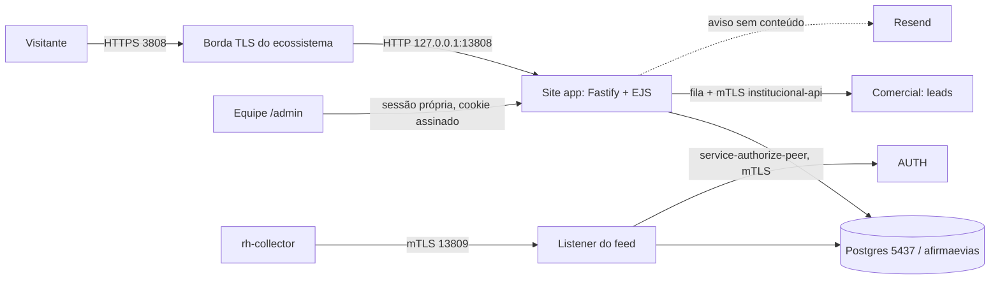

# Sistema Site Institucional (Afirma E-vias): documentação completa

Documento de referência para o dono do projeto e para engenheiros novos. Escrito em 13/11/2026 a partir da leitura do
código deste repositório (`src/`, `db/schema.sql`, `src/views/`, `README.md`, `docs/`) e de `aevias-auth/ecossistema`.
Convenção: o que aparece aqui foi conferido no código ou no ambiente local; o que não foi confirmado está marcado
**não verificado**. Nenhum segredo, senha, e-mail ou dado pessoal real é reproduzido aqui.

Documentos relacionados: [feed-rh-institucional.md](feed-rh-institucional.md) (feed ao RH, fonte detalhada desta área),
[conexao-1-comercial.md](conexao-1-comercial.md), [arquitetura/README.md](../arquitetura/README.md) (série 01 a 07),
[LGPD.md](../LGPD.md), [RESPOSTA-A-TITULARES.md](../RESPOSTA-A-TITULARES.md), [INCIDENTES.md](../INCIDENTES.md).

## 1. Propósito e escopo

Site público institucional da Afirma E-vias (engenharia, laboratório e controle tecnológico), sem WordPress nem CMS: o
conteúdo mora em `src/content.ts`. Além de páginas estáticas, ele **recebe dados de terceiros** por formulários e, por
isso, carrega as obrigações de LGPD do sistema.

O que o código implementa:

- **Páginas públicas** (12 rotas indexáveis, mais `/bruno_magalhaes`, não indexável, com vídeo do YouTube).
- **Formulário de contato** (`POST /contato`): vira registro em `contatos` e, com a integração ligada, lead no Comercial.
- **Candidatura / envio de currículo** (`POST /trabalhe-com-a-gente`): PDF, DOC ou DOCX até 5 MB, gravado em `bytea`.
- **Canal de relato de integridade** (`POST /programa-de-integridade`): anônimo por padrão, devolve protocolo `INT-...`.
- **Portal do titular LGPD** (`POST /portal-do-titular`): requisições do art. 18, protocolo `LGPD-...`, prazo de 15 dias.
- **Consulta pública de protocolo** (`GET /protocolo/:codigo`).
- **Consentimento de cookies** (`POST /api/consentimento`): prova de consentimento com hash do IP.
- **Painel administrativo** `/admin` para a equipe tratar tudo isso.
- **Integrações de saída**: leads ao Comercial (mTLS) e feed de candidaturas ao RH (listener mTLS próprio).

Fora de escopo (confirmado pelo código): o site não autentica visitantes, não tem área logada para candidatos ou clientes
(o botão "Área do cliente" só linka o portal do Comercial, `PORTAL_CLIENTE_URL`), não usa analytics nem CDN, e **não usa o
AUTH (login único) para o `/admin`**: o painel tem usuários e sessões próprias (seção 5).

## 2. Stack e estrutura

| Item | Valor (fonte) |
|---|---|
| Runtime | Node >= 22, ESM, TypeScript (`package.json`) |
| Servidor | Fastify 5 + `@fastify/{cookie,formbody,multipart,compress,static,view,rate-limit}` |
| Views | EJS, renderizado no servidor; sem build de frontend (`public/` servido como estático) |
| Banco | PostgreSQL via `pg` (pool de 8), extensão `pgcrypto` |
| Senhas | `bcryptjs` (custo 12) |
| Validação do contrato do feed | `ajv` + `ajv-formats` |
| Hospedagem original | Railway (`railway.json`: `npm run migrate && npm start`, healthcheck `/health`) |

Estrutura relevante:

```
src/server.ts                 app Fastify, cabeçalhos de segurança, CSP, timers (retenção, sessões), encerramento limpo
src/config.ts                 variáveis de ambiente e versão do aviso de privacidade (versaoPolitica)
src/content.ts                todo o texto do site, áreas de vaga, política de privacidade
src/routes/{site,forms,admin}.ts   páginas públicas, formulários, painel
src/auth.ts, audit.ts         sessão/senha/freio de login do painel; trilha de auditoria
src/retencao.ts, regras-retencao.ts   descarte automático
src/comercial*.ts, eliminacao-comercial.ts   conexão 1 (leads ao Comercial) e pendência de eliminação
src/integracao-*.ts           feed ao RH (contrato, produtor, listener mTLS)
src/notificacoes.ts           aviso por e-mail via Resend (sem conteúdo pessoal)
db/schema.sql                 schema idempotente (tabelas, funções, triggers)
contracts/vendor/auth-v1/     pacote de contrato vendorizado (manifest + schemas), nunca editado
src/views/{pages,admin,partials}/   templates EJS
docs/                         documentação (série arquitetura 01 a 07, LGPD, hipersistema)
```

Diagrama (visão geral):



## 3. Como subir e parar (local, Windows)

O site local é um processo gerenciado pelo ecossistema em `C:\Users\User\Desktop\aevias-auth\ecossistema`
(`servicos.mjs`, `ecossistema.mjs`). Estado de portas conferido em 13/11/2026 com `netstat`: 3808, 13808, 13809 e 5437
estavam em LISTEN.

| Porta | Papel | Origem |
|---|---|---|
| **3808** | Borda TLS pública (HTTPS) do site; `borda-tls.mjs` encaminha para a 13808 | `servicos.mjs`, processo `site` |
| **13808** | App Fastify, HTTP, `HOST=127.0.0.1`; healthcheck `/health` | processo `site-app` |
| **13809** | Listener mTLS do feed ao RH (só sobe se configurado) | `INTEGRACAO_PORT` em `site.env` |
| **5437** | Postgres do site, banco `afirmaevias` (cluster descartável em `.local-v1/ecossistema/site-pg`) | `DBS.site` |

Subir: `ecossistema/iniciar-tudo.ps1` (ou `node ecossistema/ecossistema.mjs iniciar`); parar: `ecossistema/parar-tudo.ps1`;
estado: `ecossistema/status.ps1`. A ordem do processo `site-app` é: garantir o banco `site` -> rodar
`node dist/migrate.js` com o `site.env` -> `node dist/server.js`. O ecossistema usa `dist/`, portanto **após mudar o
código é preciso `npm run build` antes de reiniciar o site-app** (o ecossistema não compila).

**`site.env`**: fica em `aevias-auth/.local-v1/ecossistema/site.env` (fora do repositório do site; permissão 0600). É
criado automaticamente na primeira subida por `prepararSite()` com `NODE_ENV`, `PORT`, `HOST`, `DB_SENHA`, `DATABASE_URL`,
`ADMIN_EMAIL`, `ADMIN_PASSWORD`, `SESSION_SECRET`, `SITE_URL`, `PORTAL_CLIENTE_URL`. Conferido por nome de chave (sem ler
valores), o arquivo atual também contém o bloco "Conexões locais do ecossistema": `COMERCIAL_API_URL`,
`COMERCIAL_MTLS_CA/CERT/KEY` e `INTEGRACAO_PORT/HOST/TLS_CERT/TLS_KEY/MTLS_CA/AUTH_URL`. Esse bloco não é gerado por
`prepararSite()`; quem o escreveu não foi verificado (existe uma cópia `site.env.antes-integracoes-...` de 12/11).
Valores nunca devem ser copiados para documentos ou commits.

Desenvolvimento sem ecossistema (do `README.md`/`docs/arquitetura/06`): `Copy-Item .env.example .env`, `npm ci`,
`node --env-file=.env --import tsx src/migrate.ts`, `node --env-file=.env --import tsx --watch src/server.ts` (porta
padrão 3000). Não há `dotenv`: o `.env` só vale se carregado por `--env-file`.

Variáveis (de `src/config.ts`, `.env.example`, `integracao-servidor.ts`): obrigatória `DATABASE_URL`; opcionais `PORT`,
`HOST`, `NODE_ENV`, `SESSION_SECRET`, `SITE_URL`, `PORTAL_CLIENTE_URL` (https; vazio desliga o link), `ADMIN_*`, `RESEND_API_KEY`
e `EMAIL_*`, `COMERCIAL_*` (conexão 1), `INTEGRACAO_*` e `RELEASE_ID` (feed). Sem `SESSION_SECRET` em produção o segredo é
sorteado a cada boot e o painel desloga a cada reinício.

## 4. Modelo de dados e retenção

Schema único e idempotente em `db/schema.sql`, aplicado por `src/migrate.ts` a cada deploy/subida. Não há histórico
numerado de migrations: alteração de tabela existente exige SQL explícito (`ALTER ... IF NOT EXISTS`, como em `cnpj`).

| Tabela | Conteúdo | Dado pessoal |
|---|---|---|
| `admin_usuarios`, `admin_sessoes` | usuários do painel (papel `admin` ou `editor`) e sessões de 12 h | sim (equipe) |
| `tentativas_login` | freio por e-mail digitado | e-mail, IP |
| `contatos` | formulário de contato (+ `cnpj` opcional, `status`, `observacao`) | sim |
| `leads_comercial` | fila de entrega ao Comercial (estado, tentativas, `lead_id`); sem cópia de dado pessoal | não |
| `eliminacoes_comercial` | pendência de eliminar no Comercial lead já entregue; só ids, datas, origem, status | não |
| `candidaturas` | candidatura + currículo em `bytea` (`arquivo_dados`), `ip`, `user_agent` | sim |
| `relatos_integridade` | relato (pode ser anônimo), protocolo `INT-` | sim, se identificado |
| `solicitacoes_lgpd` | requisição do titular, protocolo `LGPD-`, `prazo_em` = +15 dias | sim |
| `consentimentos_cookies` | escolha de cookies, versão da política, hash do IP | pseudônimo |
| `auditoria` | trilha das ações no painel (usuário, ação, entidade, IP) | e-mail e IP da equipe |
| `integracao_stream`, `integracao_outbox`, `integracao_versoes`, `integracao_snapshots`, `integracao_snapshot_itens`, `integracao_config`, `integracao_areas` | feed ao RH | não |

Retenção automática (`src/regras-retencao.ts`, executada por `src/retencao.ts` ao subir e a cada 24 h; cada regra recorta
por `criado_em`):

| Dado | Prazo |
|---|---|
| Currículos (`candidaturas`, linha inteira) | **12 meses** |
| Contatos comerciais | 24 meses (a cópia no Comercial segue o mesmo prazo, via pendência de eliminação) |
| IP e user-agent de contatos e candidaturas | zerados aos 6 meses (a linha permanece) |
| Requisições LGPD | 5 anos |
| Consentimentos de cookies | 5 anos |
| Trilha de auditoria | 12 meses (prazo marcado no código como "proposto, a confirmar com o dono") |
| Tentativas de login | 24 h |
| Relatos de integridade | **sem descarte automático** (o prazo depende do fim da apuração, decisão humana; a política publica "apuração + 5 anos") |
| Sessões do painel | removidas na expiração, rotina horária |
| Outbox técnica do feed | 90 dias (`expurgar`, a cada 6 h) |

Um teste (`src/retencao.test.ts`) cobra que os prazos do código batem com os publicados em `content.ts`. Mudar um prazo
exige alterar `regras-retencao.ts`, o texto da política e o teste.

## 5. Login do painel administrativo e permissões

- **Autenticação própria do site**, não é o AUTH. `POST /admin/login` confere e-mail e senha em `admin_usuarios`
  (`bcrypt`, hash de espera para igualar o tempo quando o e-mail não existe). Não há MFA/dois fatores (decisão do dono de
  04/11/2026 para o ecossistema; este login simplesmente não o tem).
- **Sessão**: token aleatório em `admin_sessoes`, cookie `ae_sessao` assinado, `httpOnly`, `sameSite=lax`, `secure` em
  produção, validade 12 h.
- **Freios**: rate limit de 10 tentativas por 15 min por IP na rota; freio por conta de 8 falhas em 15 min por e-mail
  digitado (janela expira sozinha, sem bloqueio permanente). A mensagem de erro é igual em todos os casos.
- **Primeiro admin**: criado pela migration se `ADMIN_EMAIL` e `ADMIN_PASSWORD` existirem e o e-mail não estiver cadastrado.
  Alterar a variável depois não muda a senha.
- **Senhas**: mínimo de 10 caracteres; a troca da própria senha (`POST /admin/minha-senha`) exige a senha atual e derruba as
  sessões do usuário.

Permissões (conferidas em `src/routes/admin.ts`). Só há dois papéis, `admin` e `editor`:

| Ação | editor | admin |
|---|---|---|
| Ver painel, listas, detalhes, auditoria, lista de usuários | sim | sim |
| Atualizar status, observação, resposta | sim | sim |
| Baixar currículo, exportar CSV (até 5000 linhas) | sim | sim |
| Trocar a própria senha | sim | sim |
| Excluir registro (eliminação LGPD) | não (403) | sim |
| Concluir pendência de eliminação no Comercial | não (403) | sim |
| Criar usuário, ativar/desativar usuário | não (403) | sim |

Observações: um admin não consegue desativar a si mesmo; não há tela de redefinição de senha de outro usuário (**não
verificado** se existe outro caminho além de SQL direto). A conta temporária de teste foi removida do banco diretamente
(ver seção 11).

## 6. Páginas e fluxos

Rotas públicas (`src/routes/site.ts`): `/`, `/afirma-evias`, `/servicos`, `/aplicativo`, `/acreditacao-e-certificacao`,
`/programa-de-integridade`, `/trabalhe-com-a-gente`, `/contato`, `/politica-de-privacidade`, `/termos-de-uso`,
`/portal-do-titular`, `/acessibilidade`, `/bruno_magalhaes` (não indexável), `/robots.txt` (bloqueia `/admin`),
`/sitemap.xml` (12 rotas), `/health` (executa `SELECT 1`), 404 e página de erro. Há ainda `/protocolo/:codigo`.

Painel (`/admin`): `login`, visão geral (métricas, últimos contatos e LGPD, série de 14 dias), `/dados/<coleção>` com
busca, filtro de status e paginação de 25 (coleções `contatos`, `candidaturas`, `relatos`, `lgpd`, `consentimentos`, todas
geradas do objeto `colecoes`; uma tabela nova entra no painel só adicionando entrada ali), detalhe, exclusão, CSV,
download de currículo, `/admin/eliminacoes-comercial`, `/admin/auditoria`, `/admin/usuarios`.

Fluxos dos formulários (todos com rate limit de 8 envios por 10 min por IP; `/protocolo` 20 por 10 min):

```mermaid
sequenceDiagram
  participant P as Pessoa
  participant S as Site
  participant DB as Postgres
  participant E as Resend
  P->>S: POST formulário (aceite obrigatório onde aplicável)
  S->>S: limpa e valida; honeypot "website" no contato
  S->>DB: INSERT (contato também cria linha em leads_comercial se a integração está ligada)
  S-->>E: aviso sem conteúdo ("leia no painel"), sem esperar nem falhar
  S-->>P: página de confirmação (relato e LGPD mostram o protocolo)
```

- **Contato**: exige nome, e-mail válido, mensagem de 10+ caracteres e aceite; CNPJ opcional com 14 dígitos.
- **Currículo**: nome, e-mail, anexo PDF/DOC/DOCX até 5 MB (confere tipo/extensão **e** assinatura dos bytes), aceite.
- **Relato**: título e relato de 20+ caracteres; identificado exige e-mail; protocolo `INT-`.
- **LGPD**: tipo válido (lista em `content.ts`), nome, e-mail e confirmação de titularidade; protocolo `LGPD-` e prazo de 15 dias.
- **Protocolo**: mostra só protocolo, tipo/status e datas; é o único dado que o relator anônimo leva.

Segurança de entrega: cabeçalhos (`X-Frame-Options`, `nosniff`, COOP/CORP, HSTS em produção) e CSP restritiva
(`default-src 'self'`; só `/bruno_magalhaes` abre exceção para YouTube).

## 7. Integrações

### 7.1 Feed ao RH (origem `institucional`)

Detalhes completos em [feed-rh-institucional.md](feed-rh-institucional.md). Resumo conferido no código:

- O site é **produtor**; o RH (`rh-collector`) puxa por mTLS. O site nunca chama o RH. Desligado sem `INTEGRACAO_PORT`; mal
  configurado, só avisa no log e o site segue de pé (`iniciarIntegracao` nunca lança).
- **Escopo: somente candidaturas.** Eventos `institucional.application.received.v1` e
  `institucional.application.status_changed.v1`; exclusão (painel, LGPD ou retenção de 12 meses) gera **tombstone**
  (`operation=delete`, `payload` vazio) e remove o item de snapshots ainda não consumidos. O evento de ação administrativa
  foi retirado pela migration (emite tombstone para o que já tinha ido antes).
- **Sem dados pessoais**: nada de nome, e-mail, telefone, mensagem, IP, user-agent, currículo ou observação; `person_id` e
  `actor_auth_user_id` são sempre `null`. `area_code` só sai se o texto bater com uma das 8 áreas publicadas.
- Mapa de status: `novo` -> `received`; `em análise`/`entrevista` -> `screening`; `descartado`/`banco de talentos` -> `closed`.
- **Listener mTLS** próprio (`13809`, `127.0.0.1` por padrão), TLS 1.2+, certificado de cliente obrigatório. Só a identidade
  `rh-collector` (SAN `urn:aevias:service:rh-collector`) passa; a cada requisição o site consulta o AUTH
  (`POST /v1/service-authorize-peer`, como `institucional-api`, com o SHA-256 do certificado) e nega em qualquer dúvida,
  sem cache positivo. Capacidades: `capabilities.read` para `/internal/capabilities` e `feed.read` para `changes`,
  `snapshots` e `reconciliation`. `/health/live` não pede capacidade (ainda exige certificado no TLS).
- Mecânica: outbox por trigger na mesma transação; cursor opaco assinado (HMAC), 410 `cursor_expired` para cursor antigo ou
  forjado (o RH refaz o snapshot); snapshots em `REPEATABLE READ`, idempotentes por `Idempotency-Key`; reconciliação por
  contagem e SHA-256 por partição; outbox retida 90 dias.
- **Estado conferido em 13/11/2026**: a porta 13809 está em LISTEN, com uma conexão estabelecida de outro processo local,
  e o `site.env` tem as chaves `INTEGRACAO_*`. A execução de 11/11 em `aevias-auth/docs/hipersistema/execucao.md` registrava
  o Institucional como `stale` (listener ainda inexistente); o estado atual da fonte no RH (`healthy` ou não) **não foi
  verificado** neste levantamento. Os testes mTLS executados em 13/11/2026 (listener real, `rh-collector` com
  `feed.read` e `capabilities.read`, negação das demais identidades e do AUTH fora do ar) foram informados por quem
  encomendou este documento; os resultados **não foram reexecutados** aqui. Os testes automáticos que cobrem o cenário
  estão em `src/integracao-feed.test.ts` (seção 9).

### 7.2 Comercial (leads institucionais)

Conexão 1 do hipersistema, detalhada em [conexao-1-comercial.md](conexao-1-comercial.md). Conferido no código:

- Desligada por padrão; só com `COMERCIAL_API_URL` (https) e os arquivos `COMERCIAL_MTLS_CA/CERT/KEY` (identidade
  `institucional-api`). Com a integração ligada, `POST /contato` grava o contato e a linha da fila `leads_comercial` **na
  mesma instrução SQL** (CTE), então não há contato sem fila.
- Envio assíncrono (`comercial-fila.ts`): rodada a cada 60 s (configurável) e uma imediata após o envio; reserva de 2 min
  contra duplicidade; recuo exponencial; `Idempotency-Key` estável por contato (`site-contato:<id>`). Comercial fora do
  ar não atrasa nem derruba a resposta ao visitante; o contato continua no `/admin`.
- Rota de destino: `POST /api/integracao/v1/comercial/leads`. Corpo estrito do contrato: empresa (ou nome da pessoa se
  vazio), CNPJ formatado, contato (nome, e-mail, telefone), serviço de interesse (assunto), mensagem (corte em 4000) e
  `privacy_version`. **IP e navegador nunca vão.** Logs só com código, status HTTP e id da fila.
- **Eliminação**: o trigger `contatos_eliminacao_comercial` (BEFORE DELETE) registra em `eliminacoes_comercial` uma
  pendência quando o lead já foi entregue (`lead_id` preenchido), por qualquer caminho (painel, retenção de 24 meses, SQL).
  Um admin conclui a pendência em `/admin/eliminacoes-comercial`, que pede ao Comercial a eliminação por mTLS. O caso de
  corrida (lead aceito depois de o contato sumir) também vira pendência.

### 7.3 Outras integrações

- **Resend** (`notificacoes.ts`): avisos por e-mail à equipe, sem identidade nem conteúdo (candidaturas incluem a área;
  relatos, protocolo/categoria/anonimato; LGPD, protocolo/tipo). Sem `RESEND_API_KEY` fica desligado; sem fila de reenvio.
- **AUTH**: usado apenas pelo listener do feed (autorização do par). Não participa do login do `/admin`.
- Terceiros (Railway, Cloudflare, GitHub, YouTube, canal externo de denúncias): ver `docs/arquitetura/05-terceiros-e-sistemas-relacionados.md`.

## 8. Segurança e LGPD

- **Minimização**: e-mails de aviso sem conteúdo; feed ao RH sem dado pessoal; fila do Comercial e pendências sem cópia de
  dado pessoal (testes cobrem as colunas); lead ao Comercial só com os campos do contrato; o detalhe do painel não carrega
  a coluna binária do currículo (consulta exclui `bytea`); IP/user-agent zerados aos 6 meses; consentimento de cookies grava
  apenas hash do IP.
- **Aviso de privacidade**: `config.versaoPolitica` = `2026-11-06` (política v1.2 em `content.ts`, marcada como **texto
  proposto, a revisar com o jurídico**). A mesma versão vai como `privacy_version` no lead e na prova de consentimento de
  cookies; teste cobra a correspondência. Aceite obrigatório em contato e currículo; confirmação de titularidade no portal.
- **Auditoria** (`audit.ts`, tabela `auditoria`): login ok/falhou/freado, logout, registro atualizado/excluído, currículo
  baixado, dados exportados, senha alterada, usuário criado/alternado, conclusão de pendência. Leitura simples não gera
  evento. Retenção de 12 meses.
- **Portal do titular**: prazo de 15 dias calculado no banco; o painel alerta quando faltam menos de 5 dias.
- **Defesas**: rate limit por rota, honeypot no contato, validação de assinatura de arquivo, CSP sem `unsafe-inline`, sem
  recurso externo (teste `terceiros.test.ts`), hash de espera contra enumeração de contas, `Sec-Fetch-Site` conferido na
  conclusão de eliminação, identificadores de SQL do painel validados ao subir.
- **Gaps humanos** (do `README.md`): nome do Encarregado, existência da caixa do titular, registro no CREA, data do
  certificado ISO 9001, backup do banco.

## 9. Testes

`npm test` = `tsc` + `node --test "dist/**/*.test.js"`. Também roda no CI (`.github/workflows/ci.yml`: `npm ci`, testes,
build e compilação de todos os templates EJS). Arquivos: `utils`, `retencao`, `terceiros`, `comercial`,
`comercial-privacidade`, `eliminacao-comercial`, `integracao-feed`. Os testes de banco (`eliminacao-comercial`,
`integracao-feed`) usam um Postgres embutido descartável do repositório `aevias_comercial_HS` e pulam se ele estiver
ausente; os de mTLS pulam sem `openssl`. Há também `npm run e2e:conexao-1` (site real + Comercial HS + AUTH e RH reais,
bancos descartáveis; resultado em `.data/e2e/resultado-conexao-1.json`). Neste levantamento **nenhum teste foi executado**.

## 10. Operação

- **Migrações**: `schema.sql` é reaplicado a cada subida; o ecossistema roda `dist/migrate.js` antes do `site-app`.
  Também publica a versão do aviso e as áreas de vaga para o feed. Não há rollback automático.
- **Logs**: produção usa o logger do Fastify (JSON); eventos de retenção, fila do Comercial e feed saem no console com
  códigos sem dado pessoal. No ecossistema local os logs ficam em `aevias-auth/.local-v1/ecossistema/logs/`.
- **Encerramento**: SIGTERM/SIGINT fecham o app e o pool, com limite de 10 s.
- **Backup**: não há automação no repositório do site. O banco local (5437) é um cluster "descartável" do ecossistema;
  se o backup dele é coberto pelo `backup.mjs` do AUTH **não foi verificado**. Em produção, confirmar o backup do
  provedor; o banco guarda currículos, relatos e requisições LGPD.
- **Incidentes**: procedimento em `docs/INCIDENTES.md`.
- **Estado do repositório**: ao escrever este documento havia alterações não commitadas de outras sessões
  (`planejamento.md`, `docs/hipersistema/contratos.md`, `public/js/*`, `src/routes/forms.ts`, views). Não foram tocadas.

## 11. Limitações e pendências

1. **Conta admin temporária de teste removida direto no banco**, sem registro na trilha de auditoria (a remoção não passou
   pelo painel, que só desativa usuários e não os exclui). Quem revisar a trilha não verá esse evento; registrar a data e
   o motivo em `execucao.md`. Nome/e-mail da conta não são reproduzidos aqui.
2. Currículos em `bytea` no Postgres: o banco e o backup crescem com cada anexo; storage externo é decisão em aberto.
3. Relatos de integridade sem descarte automático; o término da apuração não é um campo explícito no schema (**não
   verificado** como é registrado).
4. Sem fila de reenvio dos e-mails de aviso; sem `RESEND_API_KEY` ficam desligados.
5. Painel sem MFA, sem redefinição administrativa de senha e sem exclusão de usuário.
6. Prazo de 12 meses da auditoria é proposto, e o texto da política v1.2 está pendente de revisão jurídica.
7. Campo `area` da candidatura é texto livre no servidor; fora das áreas publicadas, `area_code` sai `null` no feed.
8. Feed: `linked` e `withdrawn` nunca são gerados; mudar o `SESSION_SECRET` (ou `INTEGRACAO_CURSOR_KEY`) invalida cursores
   e força novo snapshot no RH.
9. Backup do banco local, estado atual da fonte `institucional` no RH e quem gerou o bloco `INTEGRACAO_*` em `site.env`:
   **não verificados**.
10. Pendências do dono: Encarregado (DPO), caixa de privacidade, CREA, validade da ISO 9001, data do comunicado 17025.
